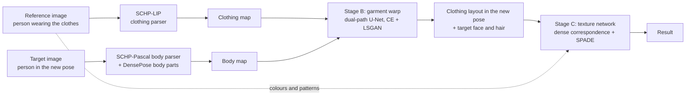
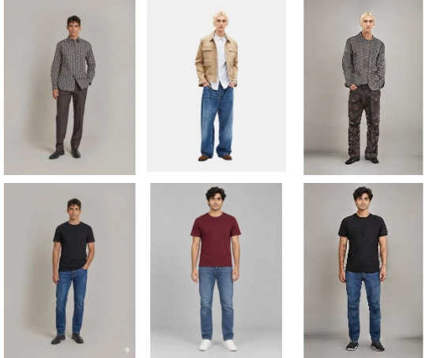
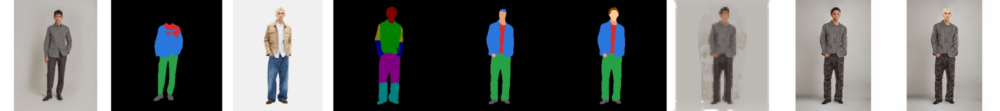
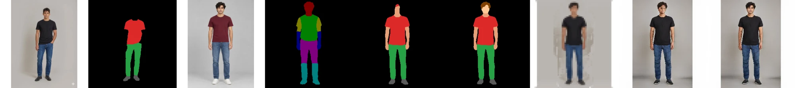
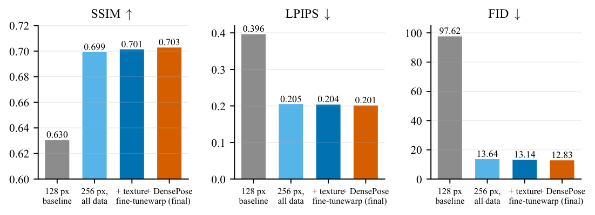
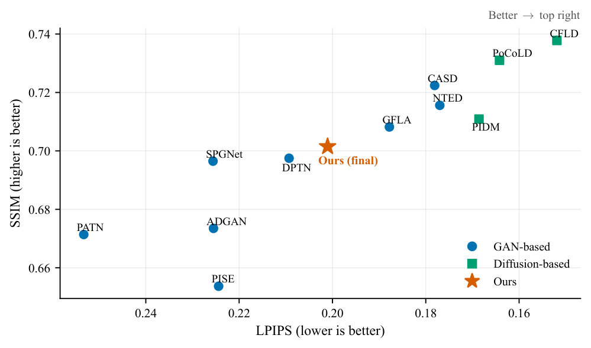
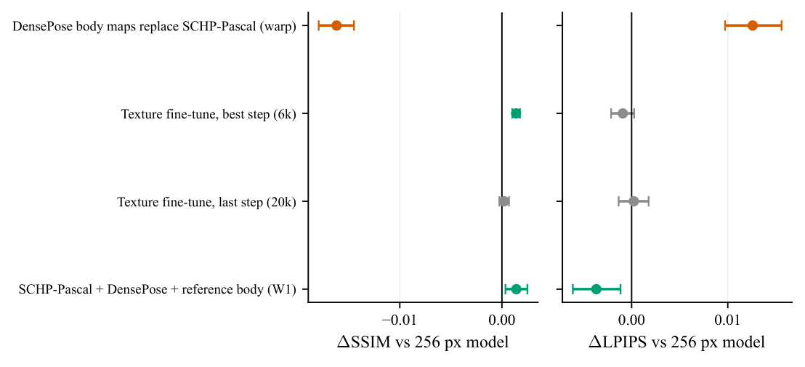

# Dress-up Revisited: segmentation-guided virtual try-on

A from-scratch PyTorch re-implementation and extension of **Dress-up** (Ghodhbani et al., *Multimedia Tools and
Applications*, 2023), a three-stage GAN pipeline that dresses a person in the clothes of another person's image.
The paper released no code, no weights and no evaluation protocol. This project rebuilds every stage, trains it on
a total cloud budget of about **$47**, and scores it on the **standard DeepFashion pose-transfer benchmark** with the
same scoring code used by the published state of the art.

**Final model (fully automatic, 7,954 standard test pairs, whole image):**
**SSIM 0.7015 · LPIPS 0.2010 · FID 12.83**: above PATN, ADGAN, PISE and SPGNet, level with DPTN, within about
0.015 SSIM of NTED (GAN, 2022) and 0.036 SSIM of CFLD (diffusion, 2024).

## How it works



1. **Pre-treatment (Stage A).** Pretrained human parsers turn the reference image into a garment label map and the
   target image into a body-part map.
2. **Garment warp (Stage B).** A dual-path U-Net redraws the garment *label map* in the target's pose. Predicting a
   layout is much easier than predicting pixels.
3. **Texture (Stage C).** A CoCosNet-style correspondence finds, for every position of the new layout, the matching
   position in the reference image, and a SPADE generator paints the final image. The target's own face and hair labels
   are kept so that identity is preserved.

## Results

### Try-on on new images

Images that were never part of the training data. Columns: **reference** (clothes to transfer) · **target**
(person to dress) · **result**.



* **Bottom:** the black T-shirt replaces the target's maroon one, while the target's face, jeans and pose are kept.
* **Top:** the checked shirt's pattern and the jacket shape transfer, but the pattern also spills onto the trousers. This
  is a typical failure: when the garment layout is uncertain, texture leaks into the wrong garment (see *Where the error
  comes from* below).

Every stage of the pipeline for these two examples (reference · its clothing map · target · its body map · predicted
layout · layout with the target's face and hair · warped texture · generated image · result):




These were produced by the demo variant of the final model (256 px warp + fine-tuned texture), which needs no
DensePose maps and therefore runs on any image.

### Model progression (standard benchmark)

| Model | Pairs | SSIM ↑ | LPIPS ↓ | L1 ↓ | FID ↓ |
|---|---|---|---|---|---|
| Copy the reference image (trivial baseline) | 7,954 | 0.514 | 0.463 | 0.158 | – |
| 128 px baseline (Colab T4) | 1,570* | 0.631 | 0.396 | 0.091 | – |
| 256 px, all 52,712 In-shop images | 7,990 | 0.699 | 0.205 | 0.068 | 13.64 |
| + texture fine-tune (pixel L1 + contextual loss) | 7,990 | 0.701 | 0.204 | 0.067 | 13.14 |
| **+ DensePose-augmented warp (final)** | 7,954 | **0.703** | **0.201** | **0.066** | **12.83** |

\*The baseline could only be scored on the pairs whose products it never trained on. Every step was confirmed on
identical pairs with paired bootstrap 95 % confidence intervals (all exclude zero).



### Comparison with published methods

Re-scored on one protocol by CFLD (CVPR 2024), DeepFashion 256 × 176; ours scored with the same SSIM code.

| Method | Type | SSIM ↑ | LPIPS ↓ |
|---|---|---|---|
| PATN (2019) | GAN | 0.671 | 0.253 |
| ADGAN (2020) | GAN | 0.674 | 0.226 |
| PISE (2021) | GAN | 0.654 | 0.224 |
| SPGNet (2021) | GAN | 0.697 | 0.226 |
| DPTN (2022) | GAN | 0.698 | 0.209 |
| **Ours (final)** | **GAN** | **0.702** | **0.201** |
| GFLA (2020) | GAN | 0.708 | 0.188 |
| NTED (2022) | GAN | 0.716 | 0.177 |
| CASD (2022) | GAN | 0.722 | 0.178 |
| PIDM (2023) | Diffusion | 0.711 | 0.169 |
| PoCoLD (2023) | Diffusion | 0.731 | 0.164 |
| CFLD (2024) | Diffusion | 0.738 | 0.152 |

Our model never saw a benchmark test product during training (the published methods trained on the standard
split, in which 439 of the 811 test products also occur). Our FID uses the real target images as the reference set,
so it is only roughly comparable with the published FIDs; rank by SSIM and LPIPS.



### Where the error comes from

Replacing automatic components by ground truth on validation try-ons shows that the **garment warp is the
bottleneck**: a perfect parser adds +0.005 SSIM, a perfect layout another +0.038.

| Setting (318 validation pairs) | SSIM ↑ | LPIPS ↓ |
|---|---|---|
| Fully automatic | 0.774 | 0.167 |
| + manual garment labels (perfect parser) | 0.779 | 0.161 |
| + true target layout (perfect warp) | **0.817** | **0.122** |



**Note on the paper's numbers.** Dress-up reports SSIM 0.95, but does not publish its test pairs, crop, resolution or
metric settings, and treats LPIPS as "higher is better". On the standard benchmark no published method, including
the 2024 diffusion models, exceeds about 0.74 SSIM, so the 0.95 could not be reproduced or compared.

## What differs from the paper

| | Dress-up paper | This implementation |
|---|---|---|
| Parsers | JPPNet and NBF (TensorFlow 1; NBF needs SMPL) | SCHP (LIP, Pascal-Person-Part) ported to pure PyTorch; DensePose body parts |
| Warp | dual-path U-Net, CE + adversarial | same, plus body-encoder skips, LSGAN PatchGAN, cross-view training triplets, and (final) body maps of both people |
| Texture | correspondence + SPADE, hinge loss only | CoCosNet loss set, layout-conditioned SPADE, fine-tune with pixel L1 + contextual loss |
| Evaluation | protocol not given | standard PATN pairs, common protocol code, product-disjoint splits, paired CIs |

All 25 deviations and their reasons: [docs/implementation_deviations.md](docs/implementation_deviations.md).

## Quick start

```bash
pip install -r requirements-dev.txt     # plus torch/torchvision (>= 2.1) for your platform
python -m pytest                        # 174 tests, CPU only, synthetic data fixture
python scripts/show_results.py          # recompute every result table from the saved per-pair scores
```

**Try on your own images** (needs trained weights, see below). Use full-body, front-facing images on a plain background:

```bash
python scripts/tryon.py --config configs/modal_full_256.yaml --reference ref.jpg --target target.jpg \
  --warp path/to/warp/generator_only.pt --texture path/to/texture/generator_only.pt
```

**Colab demo:** open [notebooks/virtual_try_on_colab.ipynb](notebooks/virtual_try_on_colab.ipynb), set
`DEMO_ONLY = True` in Section 0 and run all. Section 16 loads the final models, runs a live try-on on uploaded
images and prints every metric table.

**Training and benchmarking at 256 px** (Modal cloud, detached jobs that survive the PC disconnecting):

```bash
modal run --detach modal_app.py::train --stage warp --max-steps 60000 --gpu L40S --cpu 12 --which w1_256
modal run --detach modal_app.py::train --stage texture --max-steps 50000 --gpu H100 --which full_256
modal run --detach modal_app.py::benchmark --which w1_256
```

The full run record (GPU choice, costs, every result): [docs/modal.md](docs/modal.md).

## Repository layout

```
src/data/          datasets, label sets, splits, packed In-shop store, DensePose maps, augmentation
src/models/        SCHP port, warp network, texture network (correspondence + SPADE), discriminators
src/training/      trainers (EMA, resume, fine-tune), losses (incl. contextual loss)
src/inference/     pre-treatment and end-to-end try-on
src/evaluation/    SSIM / LPIPS / FID / KID, pose-transfer benchmark, layout eval, paired bootstrap CIs
scripts/           try-on CLI, benchmark, results tables, data tools
configs/           128 px baseline, 256 px runs (full_256, v2_256, w1_256), experiments
modal_app.py       cloud training / benchmark jobs
notebooks/         Colab notebook (training, evaluation, live demo)
docs/              design notes, experiments, evaluation protocol, results
report/data/       per-pair benchmark scores behind every number above
```

## Data and weights

* **Data:** DeepFashion In-shop and DeepFashion-MultiModal (non-commercial research use only). They are **not**
  included in this repository; download them from the official sources after accepting their licences.
* **Pretrained parsers:** SCHP weights (MIT) from the
  [official repository](https://github.com/PeikeLi/Self-Correction-Human-Parsing).
* **Trained weights:** not distributed, because they are derived from DeepFashion. Train them with the commands above.

## Project report

The full project report (method, experiments, ablations and analysis):
[docs/report/Virtual_TryOn_Project_Report_Final.pdf](docs/report/Virtual_TryOn_Project_Report_Final.pdf).

## Team

- Varun Kaushal
- Vaidehi Patel
- Smit Thakkar
- Sayali Chaudhari

Department of Computer Science and Engineering<br>
Motilal Nehru National Institute of Technology Allahabad<br>
Prayagraj, India

## Reference

H. Ghodhbani, M. Neji, A. M. Qahtani, O. Almutiry, H. Dhahri, A. M. Alimi, "Dress-up: deep neural framework for
image-based human appearance transfer," *Multimedia Tools and Applications* 82, 23151–23178 (2023).
doi:[10.1007/s11042-022-14127-w](https://doi.org/10.1007/s11042-022-14127-w)
